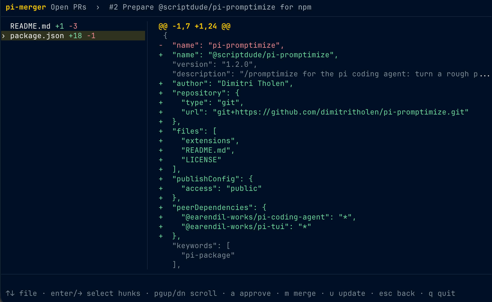

# pi-merger

A [pi](https://github.com/earendil-works/pi) extension that opens a full-screen TUI to review open GitHub pull requests. All PR data comes from the `gh` CLI.



## Install

```sh
pi install npm:@scriptdude/pi-merger
# or straight from GitHub: pi install git:github.com/dimitritholen/pi-merger
```

Then `/reload` in pi. Requires [`gh`](https://cli.github.com), logged in (`gh auth login`).

## Use

Run pi inside a git repo with a GitHub remote, then press `ctrl+shift+m` or type `/merger`.

Flow: PR list → changed files (file list left, diff preview right; stacked on terminals under 100 columns) → select hunks.

| Key | Action |
|---|---|
| `↑↓` / `jk` | move (PR, file, or hunk) |
| `enter` / `→` | open PR · select hunks in the diff |
| `pgup` `pgdn` / `space` | scroll the diff |
| `n` `p` | next / previous file |
| `c` | comment on the selected hunk: sends file path, hunk and comment to the model in the current session (not posted to the PR) |
| `a` | approve (confirm first; `gh pr review --approve`). Blocked on your own PRs |
| `m` | merge (confirm first; pick `s` squash, `m` merge commit, `r` rebase). Not for drafts |
| `u` | update branch: merge base into the PR branch (confirm first; `gh pr update-branch`) |
| `r` | refresh the PR list |
| `esc` | back |
| `q` / `ctrl+c` | quit |

Errors from `gh` (missing, not authenticated, GitHub refusals such as conflicts) show in the status line.

## Limits

First 100 open PRs only. No syntax highlighting. Single-line comments. The diff is re-fetched each time a PR is opened.

## Develop

`npm install`, then `npm test` (diff parser and `gh` error handling) and `npm run typecheck`.

## License

MIT
